# 智慧共享洗衣機狀態追蹤與逾時管理系統

STM32 NUCLEO-G474RE 微算機期中專題

## 1. 情境故事

在學校宿舍的公共洗衣空間中，經常發生使用者洗衣完成後忘記取走衣物的情況，導致其他人無法使用洗衣機。

本專題利用 STM32 模擬智慧共享洗衣機管理系統，透過 LED 顯示洗衣狀態，並記錄使用者的逾時情況。

當使用者超過規定時間仍未取衣時，系統會限制該使用者再次使用洗衣機，直到管理者解除限制。

## 2. 替身對照

本專題使用開發板及電子元件模擬實際洗衣機：

- STM32 NUCLEO-G474RE：模擬洗衣機控制系統。
- 綠色 LED：表示待機。
- 黃色 LED：表示洗衣中。
- 藍色 LED：以 PWM 呼吸燈表示洗衣完成。
- 紅色 LED：表示取衣逾時。
- PC13 按鈕：模擬洗衣中斷或取衣操作。
- Tera Term：模擬使用者操作介面。

## 3. 功能與驗收條件

| 功能 | 動作 | 預期結果 |
|---|---|---|
| 使用者登入 | 輸入 USER U01 | 顯示使用者資訊 |
| 啟動洗衣 | 輸入 CLOSE | 黃燈亮起 |
| 洗衣完成 | 等待 15 秒 | 藍色呼吸燈 |
| 正常取衣 | 輸入 TAKE | 回到綠燈待機 |
| 逾時判斷 | 完成後等待 10 秒 | 紅燈亮起 |
| 使用者限制 | 逾時後再次登入 | 顯示限制狀態 |
| 解除限制 | 輸入 UNLOCK U01 | 恢復使用權限 |
| 查詢狀態 | 輸入 STATUS | 顯示系統資訊 |
| 按鈕中斷 | 洗衣中按 PC13 | 取消洗衣 |
| 按鈕取衣 | 完成後按 PC13 | 回到待機 |

## 4. 用到的技術

1. RCC 與 PLL：設定 STM32 系統時脈。
2. GPIO：控制外接 LED。
3. EXTI：透過 PC13 按鈕產生外部中斷。
4. UART：與 Tera Term 進行串列通訊。
5. UART 接收中斷：使用 HAL_UART_Receive_IT() 接收指令。
6. Ring Buffer：使用環形緩衝區暫存 UART 資料。
7. TIM PWM：使用 TIM4_CH1 控制藍色呼吸燈。
8. HAL_GetTick()：進行洗衣與逾時計時。
9. C 語言結構：管理使用者及系統狀態。

## 5. 腳位表

| 腳位 | 元件 | 功能 |
|---|---|---|
| PB0 | 綠色 LED | 待機 |
| PB1 | 黃色 LED | 洗衣中 |
| PB10 | 紅色 LED | 逾時 |
| PB6 | 藍色 LED | TIM4_CH1 PWM 呼吸燈 |
| PC13 | 外接按鈕 | EXTI Rising Edge |
| USB Virtual COM Port | 電腦 | UART 通訊 |

## 6. 建置與執行

### 開發環境

- STM32CubeIDE
- STM32 NUCLEO-G474RE
- C 語言
- Tera Term
- GitHub Desktop

### UART 設定

- 通訊周邊：LPUART1
- Baud Rate：115200
- Data Bits：8
- Parity：None
- Stop Bits：1
- Flow Control：None

### UART 指令

| 指令 | 功能 |
|---|---|
| USER U01 | 登入 U01 |
| USER U02 | 登入 U02 |
| USER U03 | 登入 U03 |
| CLOSE | 開始洗衣 |
| TAKE | 取衣或取消洗衣 |
| STATUS | 查詢系統狀態 |
| UNLOCK U01 | 解除 U01 限制 |
| UNLOCK U02 | 解除 U02 限制 |
| UNLOCK U03 | 解除 U03 限制 |

### 操作步驟

1. 將 NUCLEO-G474RE 連接電腦。
2. 開啟 Tera Term 並選擇對應的 COM Port。
3. 設定 UART 為 115200、8N1。
4. 輸入 USER U01 登入。
5. 輸入 CLOSE 啟動洗衣。
6. 等待 15 秒後進入 DONE 狀態。
7. 輸入 TAKE 取衣，或等待 10 秒觸發逾時。
8. 使用 STATUS 查看系統狀態。

## 7. 程式結構

本專題主要使用 STM32 HAL 函式庫進行開發。

- `main.c`：主程式、系統狀態與功能控制。
- `HAL_UART_RxCpltCallback()`：UART 接收完成中斷回呼。
- Ring Buffer：暫存接收資料。
- UART 指令解析：處理 USER、CLOSE、TAKE、STATUS、UNLOCK。
- `HAL_GPIO_EXTI_Callback()`：處理 PC13 按鈕中斷。
- TIM4 PWM：控制藍色 LED 呼吸燈。
- `HAL_GetTick()`：管理洗衣時間與逾時時間。

中斷負責接收事件，主迴圈負責執行主要功能及狀態轉換。

## 8. 實作照片

### 開發板與接線

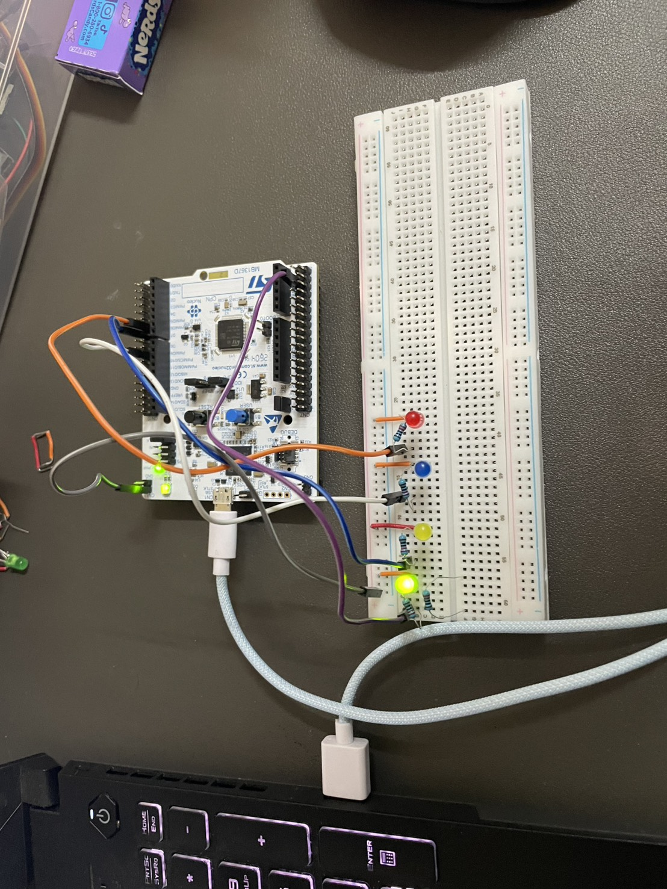

### UART 終端機畫面

**正常操作流程**

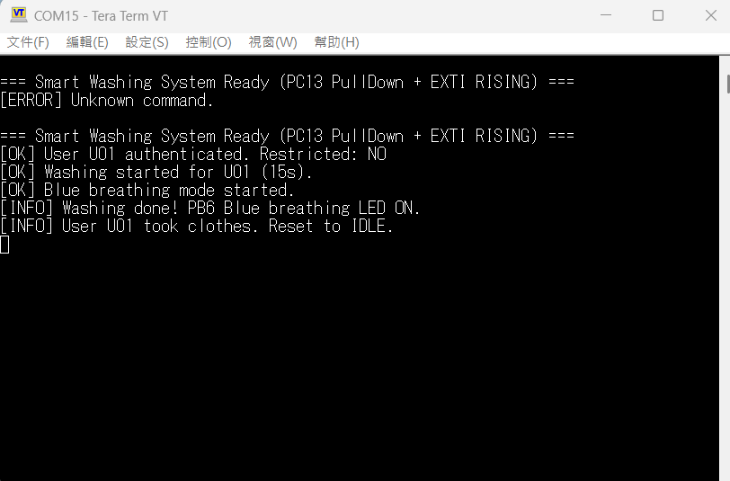

**中途按下PC13中斷鈕取衣**

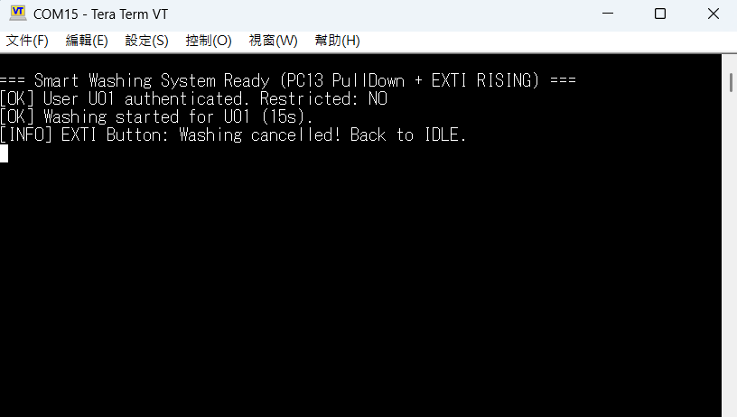

**逾時取衣與使用者限制**

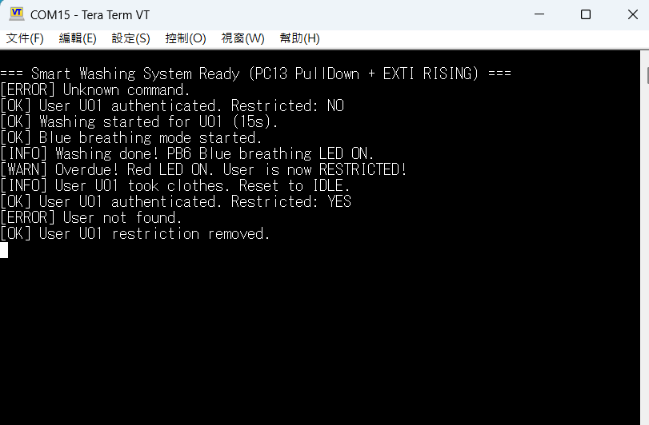

### 燈號

**綠燈：洗衣機閒置**

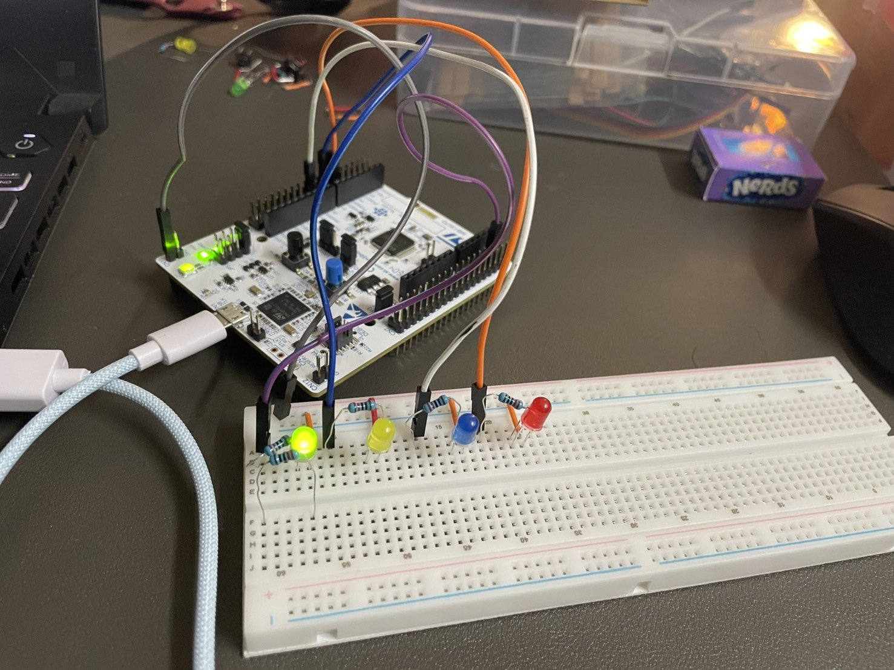

**黃燈：洗衣中**

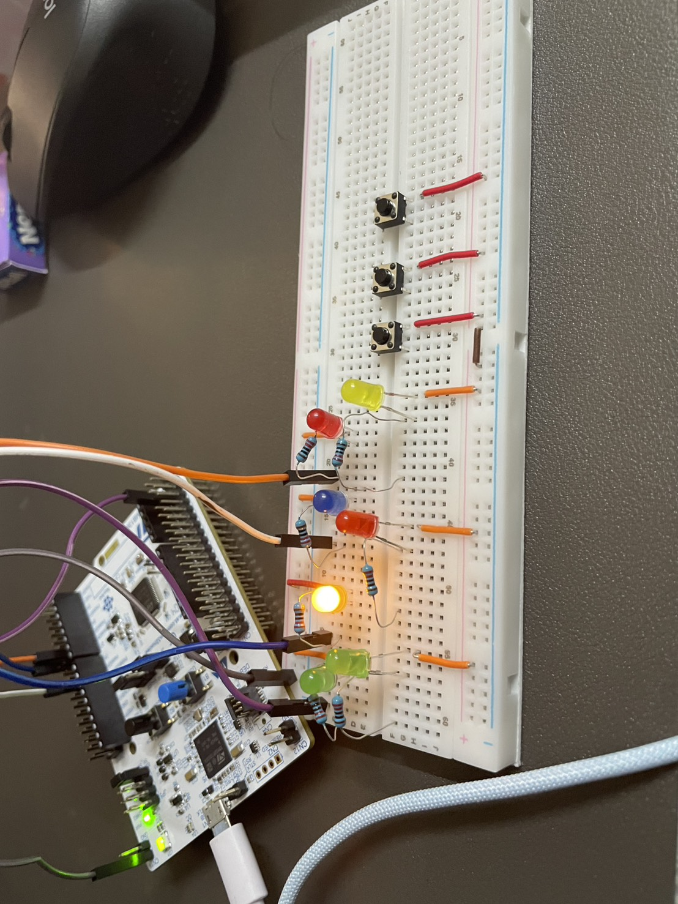

**藍燈：洗衣完成，PWM 呼吸燈**

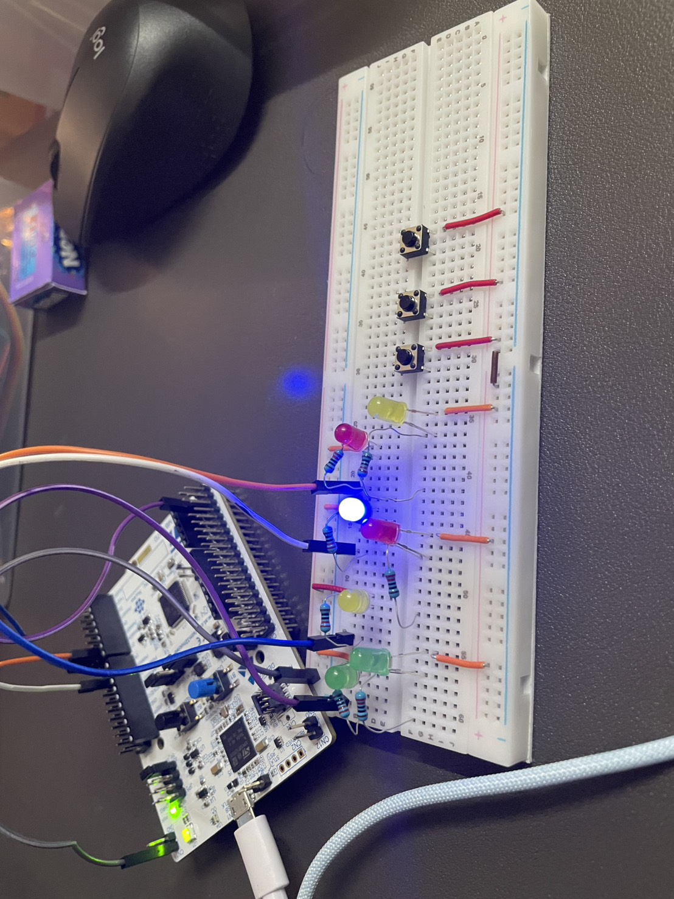

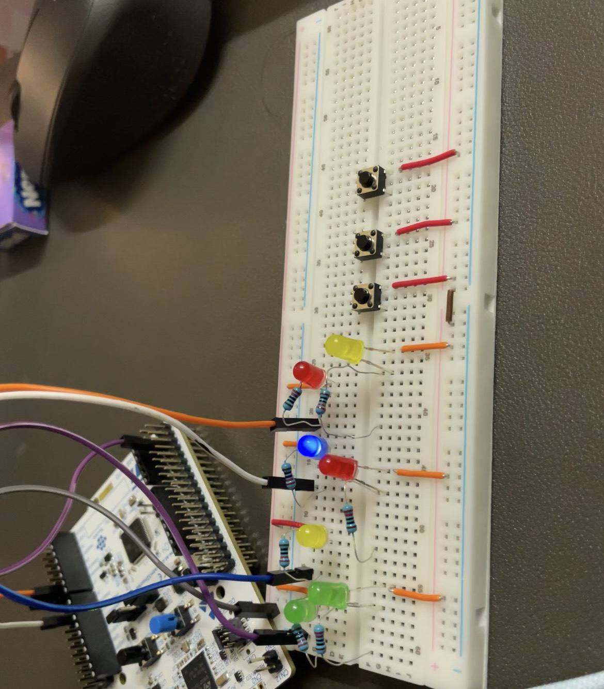

**紅燈：逾時未取衣**

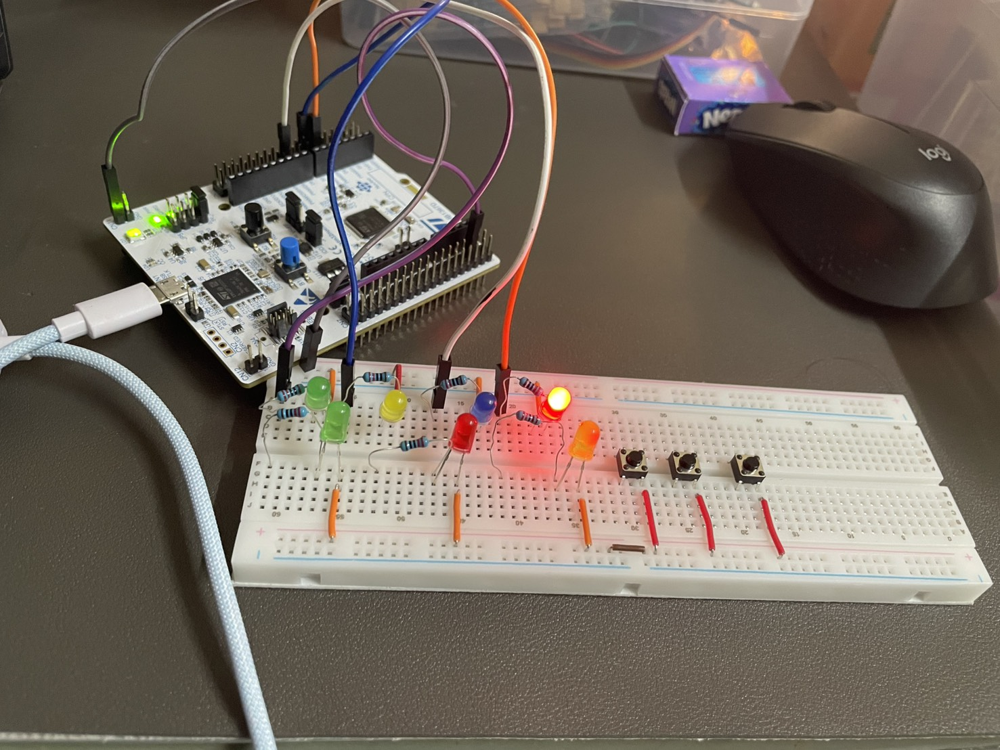

### 腳位特寫

**PB0 腳位**

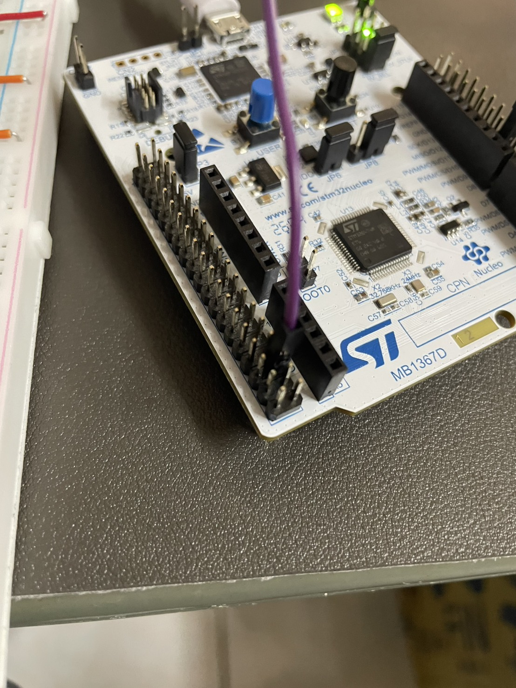

**PB1、PB10、PB6 腳位**

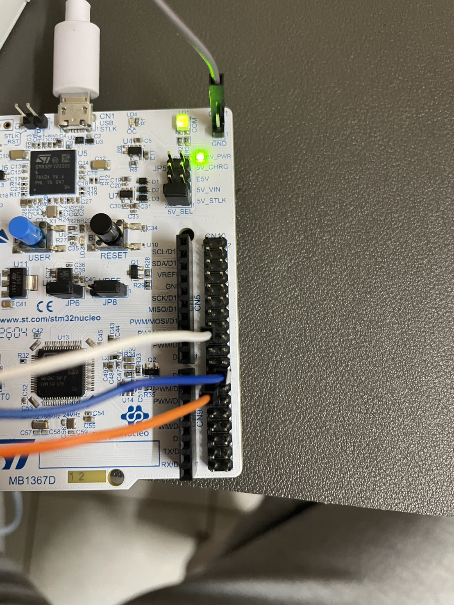)

## 9. AI 使用說明

本專題使用 AI 輔助學習 STM32CubeIDE 設定、C 語言程式架構、UART、GPIO、EXTI、PWM 與 Ring Buffer 等技術。

AI 主要協助提供程式範例、解釋程式邏輯、分析編譯錯誤，以及整理 README 文件。

專題功能仍需透過實際硬體操作及測試確認，並檢查程式是否符合設計需求。

## 10. 已知限制

1. 本系統以 LED 模擬洗衣機狀態，未直接控制真實洗衣機。
2. 使用者固定為 U01、U02、U03。
3. 洗衣時間與逾時時間使用縮短後的展示設定。
4. 使用者限制資料目前未設計為斷電後永久保存。
5. 系統需要透過 Tera Term 進行 UART 指令操作。
